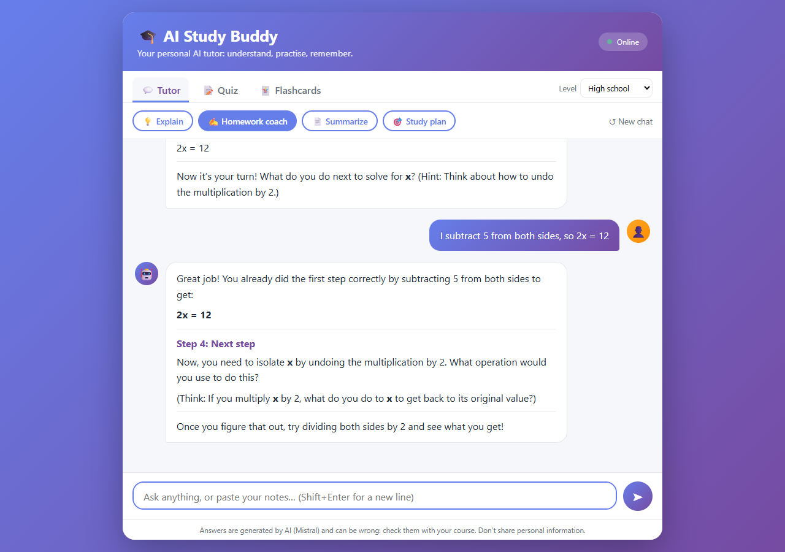
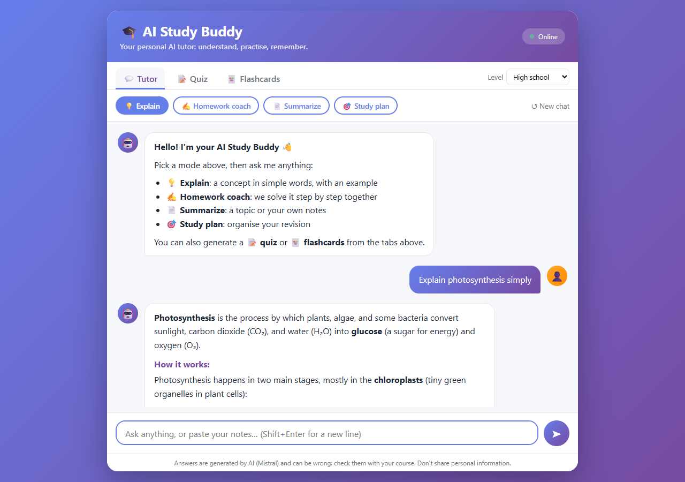
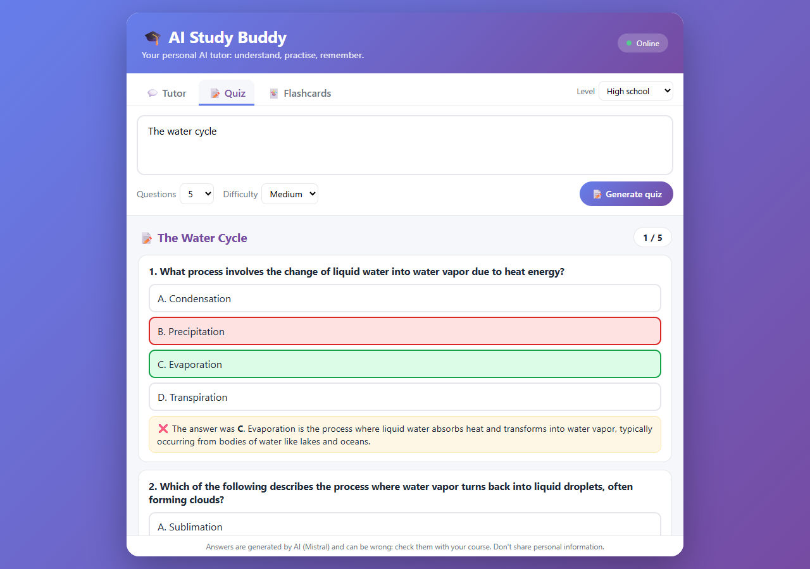
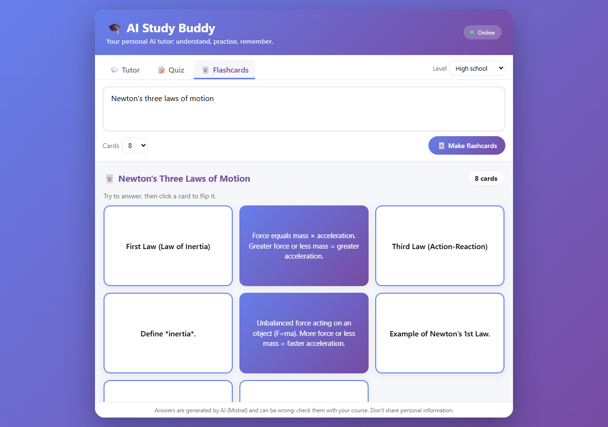
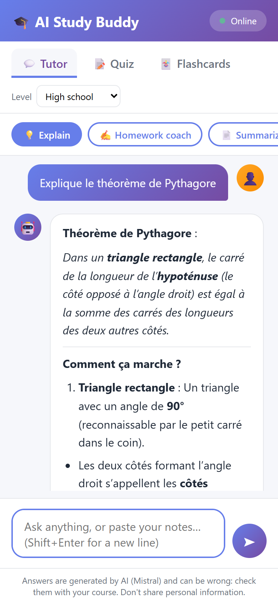

# 🎓 AI Study Buddy

**A Mistral-powered study companion for students: it explains concepts at your level, coaches you through homework
without just giving the answer, summarizes your notes, plans your revision, and turns any topic into a quiz or
flashcards.**

A side project built to make studying easier. It started as a single HTML page with pre-written answers
([docs/original_prototype.html](docs/original_prototype.html)); this version is a real app with a secure backend.



## Features

| | |
|---|---|
| 💡 **Explain** | Definition, how it works step by step, an example, a common mistake, then a question to check understanding. |
| ✍️ **Homework coach** | Socratic: it identifies the method and solves the first step with you, then asks you to try the next one. It does not write graded work for you. |
| 📄 **Summarize** | A topic or your pasted notes: overview, key points, key terms, three review questions. |
| 🎯 **Study plan** | A revision schedule with spaced repetition and active recall. |
| 📝 **Quiz** | 3-10 multiple-choice questions on any topic or your notes, easy to hard, with a score and an explanation for every answer. |
| 🃏 **Flashcards** | A deck you flip to revise with active recall. |
| 🌍 **Any language, three levels** | Answers in the student's language (French, English…), pitched at middle school, high school or university. |

| Explain (streamed answer) | Quiz with explanations | Flashcards | Mobile |
|---|---|---|---|
|  |  |  |  |

## How it works

```
browser (web/)  ──►  FastAPI (studybuddy/)  ──►  Mistral API
  chat, quiz,        - keeps the API key server-side
  flashcards         - streams answers (server-sent events)
                     - validates quiz / flashcard JSON, retries once
                     - rate limit per visitor, size limits, short history
```

- **Model:** `mistral-small-latest`, with an automatic retry on rate limits and a fallback to `ministral-8b-latest`.
- **Safety:** the key never reaches the browser; every model output is escaped before the page formats it, so an
  answer cannot inject HTML; requests are limited per visitor (12 per minute by default) to protect the quota.
- **Demo mode:** without a key, the app still runs with clearly labelled sample answers (used by the tests and CI).

## Run it locally

```bash
git clone https://github.com/<you>/ai-study-buddy && cd ai-study-buddy
python -m venv .venv && source .venv/bin/activate      # Windows: .venv\Scripts\activate
python tasks.py setup
cp .env.example .env        # then paste your key: MISTRAL_API_KEY=...  (free key at console.mistral.ai)
python tasks.py serve       # http://localhost:8000
```

`python tasks.py test` runs the 12 tests (no key or network needed).

## Deploy

GitHub hosts the code; the app itself needs a server so the key stays secret. **Do not put the key in the HTML or
on GitHub Pages: anyone could read it and spend your quota.**

1. Push the repository to GitHub (`.env` is git-ignored).
2. On [Render](https://render.com): **New > Blueprint**, pick the repository. `render.yaml` sets everything up.
3. Paste `MISTRAL_API_KEY` in the service's environment variables. Done: Render gives you a public URL.

Any Docker host works the same way (`docker build -t study-buddy . && docker run -p 8000:8000 -e MISTRAL_API_KEY=... study-buddy`).
To host only the page on GitHub Pages, set `window.STUDY_BUDDY_API = "https://<your-backend>"` before `app.js`
and add your Pages URL to `ALLOWED_ORIGINS` on the backend.

## Project layout

```
studybuddy/   config (env) · llm (Mistral client + demo) · prompts (modes, levels, quiz/flashcard formats) · app (API)
web/          index.html · style.css · app.js (no build step)
tests/        12 tests with a fake model: streaming, prompts, JSON validation and retry, rate limit, demo mode
docs/         screenshots · original prototype
```

## Limits

AI answers can be wrong: the page says so and invites students to check against their course. Conversations are
not stored on the server; nothing is logged beyond standard request logs.

## Stack

Python · FastAPI · httpx · Pydantic · Mistral API · HTML/CSS/JavaScript · pytest · ruff · Docker · Render · GitHub Actions

MIT licence.
